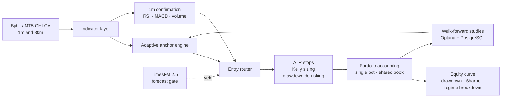

# Momentum Research Engine

Volatility-adjusted momentum, replayed tick by tick.

[](https://github.com/DawitLemmaBalcha/momentum-research-engine/actions/workflows/ci.yml)

[](LICENSE)

An event-driven research engine for volatility-adjusted momentum strategies. It
covers the full research loop: market data ingestion, indicator primitives,
adaptive anchor generation, multi-factor confirmation, risk and portfolio
accounting, walk-forward optimisation, multi-strategy ensembles, and an optional
foundation-model entry gate.

The design goal is not a prettier backtest chart. It is a replay environment
where every fill, stop, fee and sizing decision happens in the same order it
would in execution, so a strategy that survives optimisation has at least been
tested against realistic sequencing.

## Why this exists

Most retail momentum backtests are vectorised column arithmetic: signals are
computed on closes, fills are assumed at the same close, and stops are evaluated
after the fact. That hides the two things that decide whether a strategy is
real — intrabar path and position accounting.

This engine replays each bar as an ordered tick path, routes anchor fills through
a confirmation gate, updates stops and equity on the same clock, and keeps
single-bot and shared-portfolio accounting separate. The optimiser and the
ensemble runner operate on that same simulation, not on a simplified copy.

## Capabilities

| Area | What is implemented |
|---|---|
| Replay | Ordered intrabar ticks, 1-minute and 30-minute clocks, event-driven exits |
| Signals | Bollinger-width anchor spacing, regime-aware buy/sell split, pyramiding |
| Confirmation | 1-minute RSI, MACD and relative-volume gate with logged rejection reasons |
| Risk | ATR initial stop, ATR trailing activation, time stop, Kelly sizing, pyramid decay |
| Portfolio | Standalone and shared-portfolio bots, realised and unrealised equity, drawdown control |
| Research | Walk-forward studies with Optuna, PostgreSQL trial storage, parallel trials |
| Ensembles | Multi-strategy backtests with dynamic capital allocation between bots |
| Forecasting | Optional TimesFM 2.5 entry gate with caching, fail-open/fail-closed modes |
| Quality | Pytest suite, GitHub Actions CI, typed configuration modules |

## Architecture



The simulation core is shared by the single-bot runner, the ensemble runner and
the live loop. A change to fill logic or risk behaviour lands in one place and is
exercised by all three paths.

## Design highlights

**Intrabar sequencing.** Each bar is replayed as `open → low → high → close` or
`open → high → low → close` depending on direction, so a stop and a reversal in
the same bar are evaluated in a defined order.

**Regime-aware anchors.** Anchor spacing scales with Bollinger-band width, while
the buy/sell anchor split follows a trend classification built from EMAs, RSI,
MACD and band width. Ranging regimes trade a smaller grid than trending ones.

**Confirmation, not prediction.** An anchor only fills when short-timeframe
momentum agrees with the anchor direction. Rejections are recorded with the
failing factor rather than silently dropped.

**Risk as a first-class layer.** Position size is the minimum of a Kelly fraction
and a hard percentage cap, decayed across pyramid entries. Equity drawdown cuts
sizing along a configurable curve and restores it gradually after a new peak.

**A research loop, not a single run.** The optimiser runs rolling walk-forward
windows rather than one in-sample fit, stores trials in PostgreSQL so studies can
run concurrently, and feeds the winning parameter sets into the ensemble
configuration as ordinary Python modules.

**A foundation-model gate that is optional by construction.** TimesFM is lazy-
loaded, cached per bar window, and can be switched off without touching the
strategy path. The engine has no hard dependency on PyTorch.

## Project structure

| Path | Purpose |
|---|---|
| `config.py` | Default strategy and risk parameters |
| `strategies/cluster_*.py` | Parameter sets for ensemble members |
| `core/trading_bot_base.py` | Shared anchor, exit, sizing, risk and forecast-gate logic |
| `core/trading_bot.py` | Standalone bot (model A) |
| `core/trading_bot_shared.py` | Portfolio-shared bot (model C) |
| `simulation/backtest_runner.py` | Single-bot event backtest |
| `simulation/backtest_runner_shared.py` | Multi-bot ensemble backtest |
| `simulation/data_fetcher.py` | Bybit OHLCV download and indicator preparation |
| `analysis/` | Walk-forward and ensemble optimisation |
| `deployment/` | Ensemble backtest runner and live loop |
| `forecasting/` | Optional TimesFM gate and adapter |
| `tests/` | Forecast gate, history and bot-integration tests |

## Quick start

Python 3.10-3.12 is required. The pinned requirements were resolved on 3.11.

```bash
python -m venv .venv
source .venv/bin/activate
pip install -r requirements.txt
cp .env.example .env        # add BYBIT_API_KEY and BYBIT_API_SECRET
python main.py
```

`main.py` downloads the configured date range, runs the event backtest and
writes a log to `logs/`. The symbol, timeframe and date range live in
`config.py`. Read-only market data does not require trading permissions; a
public Bybit connection is enough for many endpoints, but the connector expects
credentials to be present.

## Research workflow

1. **Single backtest** with `python main.py` to validate a parameter set.
2. **Walk-forward study** with `python -m analysis.walk_forward_ensemble_optimizer`,
   which writes results under `results/` and logs under `logs/`.
3. **Ensemble backtest** over the chosen strategy clusters, with per-bot capital
   allocation and shared-portfolio accounting.
4. **Paper / live loop** through the deployment entry point once the behaviour is
   understood on a demo account.

## Configuration

`config.py` holds the defaults. Each file under `strategies/` is a complete
parameter set for one ensemble member; `deployment/ensemble_config.py` decides
which ones run and how capital is allocated.

| Parameter | Meaning |
|---|---|
| `NUM_ANCHORS`, `ANCHOR_BAND_MULTIPLIER` | Grid density and spacing |
| `RSI_BUY_CONFIRMATION`, `RSI_SELL_CONFIRMATION` | Confirmation thresholds |
| `VOLUME_CONFIRMATION_FACTOR` | Relative-volume requirement |
| `ATR_INITIAL_STOP_MULTIPLIER`, `ATR_TRAILING_STOP_MULTIPLIER` | Stop distances |
| `MAX_DRAWDOWN_PERCENT`, `DE_RISK_*` | Drawdown response |
| `MAX_POSITION_SIZE_PERCENT`, `KELLY_FRACTION` | Sizing ceilings |

## Optional TimesFM entry gate

The engine can consult Google Research's [TimesFM](https://github.com/google-research/timesfm)
before filling an anchor: if the model's short-horizon path does not support the
anchor direction, the entry is vetoed. The feature is off by default.

**Why TimesFM 2.5.** The adapter targets `google/timesfm-2.5-200m-pytorch`.
TimesFM 2.5 weights are Apache-2.0; TimesFM 3.0 weights are distributed under a
non-commercial licence, so they are not the default here.

**Install.**

```bash
pip install -r requirements-timesfm.txt   # timesfm[torch], Python 3.10-3.12
```

The first forecast downloads the checkpoint from Hugging Face.

**Enable.**

```python
TIMESFM_ENABLED = True
TIMESFM_HORIZON = 5              # 1-minute bars ahead
TIMESFM_MIN_AGREEMENT = 0.6      # share of steps that must agree
TIMESFM_MIN_CONTEXT = 64
TIMESFM_CACHE_BARS = 5
TIMESFM_FAIL_OPEN = False        # veto entries when the model is unavailable
```

**Behaviour.**

- The gate sees only the close history up to the decision bar. The backtest
  runners call `bot.observe_close(timestamp, close)` once per bar before the
  tick loop, and the live loop does the same. There is no look-ahead.
- A forecast is cached for `TIMESFM_CACHE_BARS` bars and invalidated as soon as
  the latest close changes.
- If the model is missing or fails, entries are vetoed by default. Set
  `TIMESFM_FAIL_OPEN = True` to trade without the gate instead.
- The gate never changes position size or exits; it only accepts or rejects an
  entry.

The unit tests use a deterministic stub backend, so they run without PyTorch or
model weights. Loading the real checkpoint is not covered by CI.

## Tests

```bash
pip install numpy pandas pytest python-dotenv
python -m pytest tests -q
```

The suite covers gate agreement, caching, fail-open/fail-closed behaviour,
history ordering, and the entry hook in the bot. CI runs it on Python 3.10 and
3.12.

## Limitations

- The backtester models fees and slippage approximately; results are sensitive
  to the data range and to the parameters chosen by the optimiser.
- Walk-forward results are not a guarantee of future performance.
- The live loop depends on exchange connectivity and on correct API permissions.
- The ensemble allocation logic is tuned for the included strategy sets, not a
  general portfolio optimiser.
- This is research software. It is not investment advice and it is not a
  turnkey trading product.

## License

MIT. See `LICENSE`.
